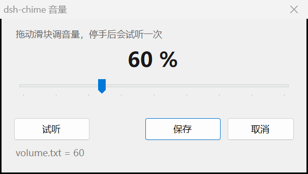

# dsh-chime

DSH（DeepSeek Harness）答完话、或者停下来等你拍板的时候，响一声。

- **运行时不花 token**：它不调用模型，也不往对话里塞任何内容。每响一次的代价是起一个几毫秒的小进程。
- **不碰桌宠**，跟任何宠物插件互不干扰。
- **只支持 Windows**：两个小程序都是 .NET Framework 程序（Windows 自带，不用装运行时），仓库里已经编译好了，不用你自己编译。

## 什么时候响

| 时机 | 声音 | 触发条件 |
|---|---|---|
| 答完了 | `ding` 柔和木琴 F4→C5（约 0.8 秒） | `turn/end` 且 `reason=completed` |
| 需要你回答／拍板 | `alert` 三声上行 | 工具 `ask_user_question`；或 `reason=blocked`、`approval/asked` |
| 这轮挂了（报错／超长） | `sad` 两声下行 | `reason=error` / `max-tokens` |
| 你自己按了停止 | 静音 | `reason=aborted` / `interrupted` |
| 子代理干完了 | 静音 | session 带 `origin=subagent` |
| 两声挨得太近 | 静音 | 默认 900ms 内不重复；更急的（alert）可以挤进来 |

试听（GitHub 上点开就能放）：[ding](docs/sounds/ding.wav) · [alert](docs/sounds/alert.wav) · [sad](docs/sounds/sad.wav) · [drop](docs/sounds/drop.wav)

音色都是**敲击后指数衰减**（钟／木琴的形状），不是平音硬切——后者听起来就是蜂鸣器。
想要别的音色，`bin\chime.exe` 还带一个水滴声 `drop`。

## 装上

### 方式一：让 DSH 自己装（推荐）

对你的 DSH agent 说：

```
plugin_manager install_bundle target="github:rain-joke-debug/dsh-chime"
```

装完声音就能用。**但插件页里的音量滑块要重开一次 DSH 才会出现**——宿主把包元数据缓存到重启，刷新页面（F5）没用。

### 方式二：手动改 profile

在这个 profile 的 `package.json` 里：

```json
{
  "dsh": { "profile": { "bundles": ["...", "dsh-chime"] } },
  "dependencies": { "dsh-chime": "github:rain-joke-debug/dsh-chime" }
}
```

然后 `pnpm install`，重开 DSH。

### 方式三：本地开发

```json
"dependencies": { "dsh-chime": "link:D:/path/to/dsh-chime" }
```

## 改音量

**就在 DSH 里调（推荐）**：网页界面 → **插件** → `dsh-chime` → 详情页最上面那个滑块。拖一下 → 松手即保存 → 立刻用新音量响一声，所以你听到的就是屏幕上那个数，不用离开 DSH，也不用重启。

不想开 DSH 的话，还有两个入口：双击 `bin\chime-volume.exe`，或者命令行。



两种界面做的是同一件事：拖滑块 → 停手自动试听一次。

音量是百分比，`100` 是调好的标准音量，`0` 静音，超过约 `130` 大声的地方会削顶（clipping）。

| 方式 | 什么时候生效 | 怎么做 |
|---|---|---|
| **插件页滑块** | **下一声立刻生效** | 网页界面 → 插件 → `dsh-chime`，拖滑块 |
| 音量窗口 | **下一声立刻生效** | 双击 `bin\chime-volume.exe` |
| 命令行 | **下一声立刻生效** | `powershell -File tools\volume.ps1 60` |
| 自己写文件 | **下一声立刻生效** | 在插件目录建 `volume.txt`，内容就一个数字 |
| 配置里的 `volume` | 重载插件后 | 见下面的配置示例 |
| 只想试听 | 不改设置 | `bin\chime.exe ding 60` |

这几个入口写的都是同一个 `volume.txt`；`impl.js` 每次响之前重读它，所以调音量不用重启 DSH，也不用重载插件。

插件页的滑块跟其它几个入口有一点不同：页面读不到 `volume.txt`，所以它是通过宿主半开的一个本地路由 `/dsh-chime/volume` 来读写的。那个路由只放行本机地址（`localhost` / `127.0.0.1` / `[::1]`），其它来源交给 DSH 自己的连接校验去拒——把 `Host` 改成别的域名会被挡成 403。

## 配置

在 profile 的 `cordis.patch.yml` 里覆盖 `id: turn-chime` 那一节：

```yaml
- id: turn-chime
  config:
    onTurnEnd: false    # 只在需要你的时候响，答完不响
    volume: 60          # 音量 60%
    minGapMs: 2000      # 别太吵
```

| 键 | 默认 | 意思 |
|---|---|---|
| `enabled` | `true` | 总开关 |
| `onTurnEnd` | `true` | 正常答完响 `ding` |
| `onAsk` | `true` | 需要你拍板时响 `alert` |
| `onProblem` | `true` | 报错／超长时响 `sad` |
| `minGapMs` | `900` | 两次响声的最小间隔（毫秒） |
| `volume` | `100` | 音量百分比，0–200 |

改完 `cordis.patch.yml` 需要重开 DSH。**音量是例外**：插件页滑块、音量窗口、`volume.txt` 都是免重启的。

## 自己编译

改了 `src\*.cs` 才需要（仓库里的两个 exe 都是编译好的）：

```powershell
powershell -NoProfile -ExecutionPolicy Bypass -File tools\build.ps1
```

用的是 Windows 自带的 `csc.exe`（C# 5），不需要 Visual Studio。

## 测试

```powershell
node test\host.test.mjs
```

56 项检查，覆盖判定逻辑、子代理过滤、配置开关、音量解析，以及插件页用的那个音量路由（读写、参数校验、只认本机来源）。**测试不会发出声音。**

## 目录

```
boot.js                 Loader 入口（带时间戳动态导入，改代码不用重启 DSH）
impl.js                 宿主半：订阅 session/event，判定要不要响，按音量起播放器
client.js               浏览器半：插件页里那个音量滑块，走宿主半的 /dsh-chime/volume 路由
cordis.patch.yml        安装时自动插入的 loader 行（id: turn-chime）
src/chime.cs            播放器源码（C# 5，内存里合成波形，不带音频文件）
src/volume.cs           音量窗口源码（WinForms，只有一个滑块）
bin/chime.exe           播放器（编译产物）
bin/chime-volume.exe    音量窗口（编译产物）
tools/build.ps1         编译上面两个 exe
tools/app.manifest      音量窗口的清单：现代控件样式 + DPI 感知
tools/volume.ps1        命令行改音量 + 试听
test/host.test.mjs      单测
docs/sounds/*.wav       导出的音频，给别的程序用，也方便试听
docs/volume-window.png  音量窗口截图
chime.log               运行日志（每次响都记一行，gitignore）
volume.txt              音量覆盖值（gitignore）
```

## 已知限制

- **只有 Windows**。播放走的是 .NET 的 `SoundPlayer`，音量窗口是 WinForms。
- 插件页那个滑块只在 DSH 的**网页界面**里有（`client.js` 声明的是 `platform: web`）。用终端界面的话，改音量走音量窗口或 `volume.txt`；声音本身跟界面无关，两边都响。
- agent 用普通文字提问（不走 `ask_user_question` 工具）时，只会响普通的 `ding`——那种提问没有独立的会话事件，分辨不出来。
- 音量窗口只管插件自己这一层的音量，系统音量、输出设备不是它管的。
- 音量窗口的布局按系统 DPI 缩放；拖到缩放比例不同的另一个显示器上不会重新排版，重开一次即可。

## License

MIT
